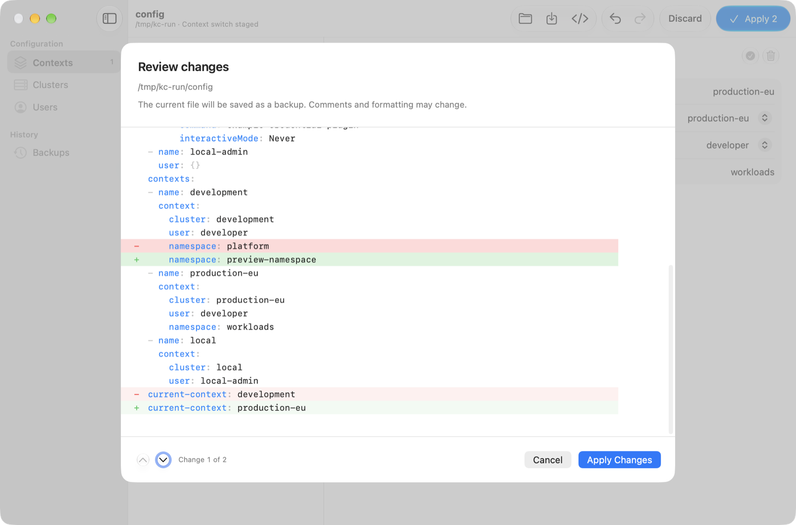

# KubeConfig

A native macOS app for editing a local kubeconfig. Import a provider's
configuration, switch contexts, review every change before it is written, and
roll back if it goes wrong. Open it, do the job, and quit.

Editing `~/.kube/config` by hand means merging YAML from each provider, fixing
name clashes, and hoping a typo doesn't lock you out of a cluster. KubeConfig
stages your edits as a draft, shows a diff of the whole file, and saves the
previous file as a backup on every Apply. It never connects to a cluster or runs
a credential plugin itself. If you have k9s installed, you can open a context in
it right in the window.



## Features

- Browse and search contexts, clusters and users, with forms for each.
- Switch the active context with a double-click. It changes only `current-context`, so comments and formatting survive.
- Import from a file or pasted YAML, with proposed names for conflicts and a check for missing references.
- Stage edits as a draft with Undo and Redo, then step through a diff before Apply.
- A syntax-highlighted YAML editor for the full file, one toggle away.
- Exact-bytes backups after each Apply, with searchable history and one-step rollback.
- Atomic writes, and a refusal to overwrite a file that changed outside the app.
- Liquid Glass interface in light and dark mode.

## Install

You need macOS 26 or later.

With Homebrew:

```sh
brew install ivalkenburg/tap/kubeconfig
xattr -dr com.apple.quarantine /Applications/KubeConfig.app
```

KubeConfig is not notarized by Apple, so macOS blocks its first launch. The
`xattr` line allows it. You can also open it once and click "Open Anyway" in
System Settings › Privacy & Security.

### Build from source

You need Xcode 26.

```sh
git clone https://github.com/ivalkenburg/kubeconfig.git
cd kubeconfig
make install-production
```

This builds the app and copies it to `/Applications`. Run `make help` for the
other targets, and `make test` for the test suite.

## Usage

The app opens `~/.kube/config`, or choose another file with **Open
Configuration…**. To try it on the bundled example instead of your own config:

```sh
open -n /Applications/KubeConfig.app --args --config "$PWD/Examples/sample-config.yaml"
```

See [docs/USAGE.md](docs/USAGE.md) for editing, imports, backups and limits.

## Security

Credentials are shown in plain text in forms, the YAML editor, diffs and
previews. Backups, stored under `~/Library/Application Support/KubeConfig/Backups/`,
contain credentials too. They are owner-only (`0600`) and not encrypted.

## License

MIT. See [LICENSE](LICENSE). Third-party notices are in
[Resources/ThirdPartyNotices.txt](Resources/ThirdPartyNotices.txt).
